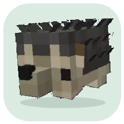

# Hedgehog Desktop

A small pixel-style hedgehog that walks, slides and spins on your Windows desktop.

## Download

Download [**HedgehogDesktop-Windows-English.zip**](https://github.com/drago139/HedgehogDesktop/releases/latest/download/HedgehogDesktop-Windows-English.zip), extract it to a writable folder, and run **HedgehogDesktop.exe**.

Windows10/11 with .NET Framework4.8. No installer, Python, external video player or internet connection required.

## Features

- Multiple independently moving hedgehogs with one tray icon.
- English menus, tooltips and error messages.
- Throw in any screen direction: sliding momentum, spinning animation, edge rebounds and gradual stopping.
- Circular mouse pickup area, including transparent gaps inside the circle.
- Three sizes, three walking speeds, entire-screen/bottom-edge walking and monitor switching.
- Embedded75-frame walking and78-frame spread-leg spin animations.

## Controls

| Action | Control |
| --- | --- |
| Move | Hold left mouse button and drag |
| Throw | Drag quickly and release |
| Catch | Grab a sliding hedgehog |
| Place gently | Drag slowly, or stop moving before releasing |
| Pause / resume | Double-click a hedgehog |
| Add, size, speed, walking area, remove | Right-click a hedgehog |
| Add another | Launch the EXE again, or double-click its tray icon |
| Exit | Right-click and choose **Remove all hedgehogs** |

Preferences are saved to `settings.xml` next to the EXE. Keep that file when updating. Each fresh session starts with one hedgehog.

## Source

[**HedgehogDesktop-Source.zip**](https://github.com/drago139/HedgehogDesktop/releases/latest/download/HedgehogDesktop-Source.zip) contains the C# sources, build script, animation resources and tests. Extract it, then run `powershell -ExecutionPolicy Bypass -File .\Build.ps1` on Windows with .NET Framework4.8. The build runs the tests before producing `App/HedgehogDesktop.exe`.

## Notes

- Circular pickup is a mouse hit area; pets do not collide with one another.
- Motion is in the screen's X/Y plane; there is no height/Z simulation.
- The spin clip comes from generated footage and retains some pose/outline variation.
- Multi-monitor hardware switching and high-pet-count performance were not tested on multiple physical monitors.
- This release is not code-signed.

## Artwork

Character reference supplied by the project owner. The spin animation was extracted from owner-supplied footage generated with Google Gemini. Sprite preparation preserves reference colors and uses nearest-neighbor scaling. This project is not affiliated with Google, Mojang or Microsoft.
